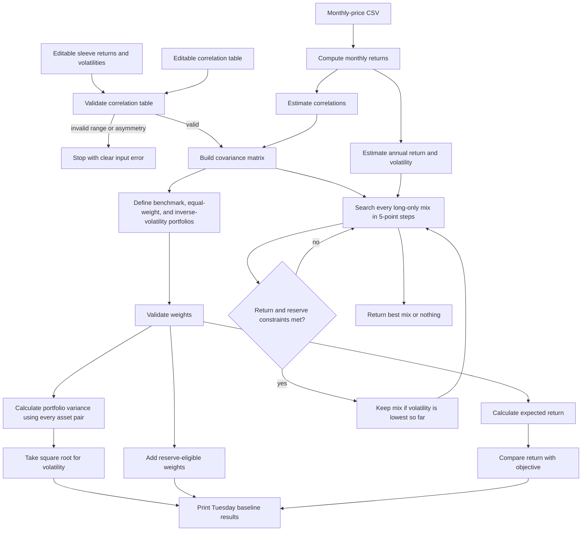

# Lab 14: Portfolio Baselines

## Meridian inputs

| Sleeve | Expected return | Volatility |
|---|---:|---:|
| Treasury bills | 3.5% | 0.5% |
| 10-year Treasury note | 4.3% | 7.0% |
| Investment-grade bond fund | 5.0% | 6.0% |
| Global equity index fund | 8.0% | 16.0% |

The objective return is **6.5%**, based on estimated CPI of 2.5% plus 4%. Treasury bills and the 10-year Treasury note are reserve-eligible.

## Verified baseline results

| Portfolio | Bills | 10-year | IG bonds | Equity | Return | Volatility | Reserve-eligible | Meets 6.5%? |
|---|---:|---:|---:|---:|---:|---:|---:|:---:|
| Benchmark | 0.0% | 0.0% | 40.0% | 60.0% | 6.80% | 10.46% | 0.0% | Yes |
| Equal weight | 25.0% | 25.0% | 25.0% | 25.0% | 5.20% | 5.21% | 50.0% | No |
| Inverse volatility | 84.3% | 6.0% | 7.0% | 2.6% | 3.77% | 1.05% | 90.3% | No |

## Engine checks

`portfolio.py` computes covariance as correlation multiplied by both sleeve volatilities. Portfolio variance includes every asset pair and portfolio volatility is the square root of that variance.

The engine refuses to run when:

- Any correlation is outside -1 to +1.
- The correlation table is not symmetric.
- Portfolio weights are negative, omit a sleeve, or do not total 100%.

The benchmark's 10.46% volatility confirms that the IG-equity correlation term is included. Changing both symmetric IG-equity correlation cells from 0.25 to 0.50 raises benchmark volatility to 11.00%.

## Run command

```powershell
cd C:\Users\15453\myproject
python portfolio.py
```


## `portfolio.py` flowchart




## Portfolio engine picture


