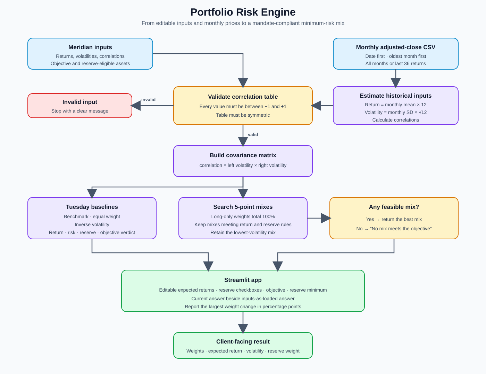

# Lab 15: Streamlit Portfolio App

## Question

Which mix carries the least risk while meeting the mandate, and does the answer survive a one-point change in one estimate?

## Files

- `portfolio.py`: reusable risk engine, validation, CSV estimator, and five-point grid search.
- `app.py`: Streamlit interface that imports the engine rather than copying its math.
- `prices.csv`: 60 completed months of adjusted-close prices.
- `project2-universe.md`: Project 2 funds, roles, data sources, and download date.
- `portfolio-engine-flowchart.svg`: rendered engine flowchart.

## Meridian verification

| Run | Bills | 10-year | IG bonds | Equity | Return | Volatility |
|---|---:|---:|---:|---:|---:|---:|
| Inputs as loaded | 0% | 20% | 25% | 55% | 6.51% | 9.44% |
| Equity return changed from 8.0% to 7.0% | 0% | 10% | 10% | 80% | 6.53% | 12.94% |
| IG-equity correlation changed to 0.50 | 0% | 40% | 0% | 60% | 6.52% | 9.73% |

Changing the equity return estimate by one percentage point changes the largest portfolio weight by **25 percentage points**. Both IG-equity correlation cells were restored to 0.25 after the engine proof.

## Project 2 results

Mandate used without relaxing it: estimated return of at least **6.0%**, at least **10.0%** reserve eligible, with SGOV marked reserve eligible.

| Price window | SGOV | GOVT | IGIB | VT | Return | Volatility | Reserve |
|---|---:|---:|---:|---:|---:|---:|---:|
| All available monthly returns | 65% | 0% | 0% | 35% | 6.32% | 5.31% | 65% |
| Last 36 monthly returns | 90% | 0% | 0% | 10% | 6.02% | 1.21% | 90% |

Largest allocation change: **SGOV, 25 percentage points**. Historical estimates are not forecasts.

## Flowchart



## Run the app

```powershell
cd C:\Users\15453\myproject
.venv\Scripts\streamlit.exe run app.py --server.port 8502
```

Built with AI help, a learning demonstration, not investment advice.
